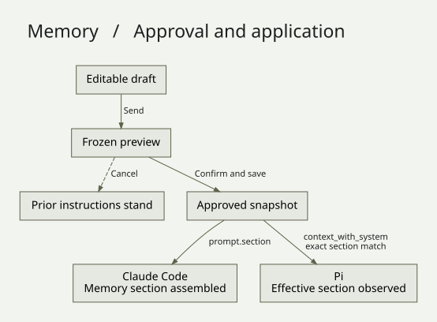
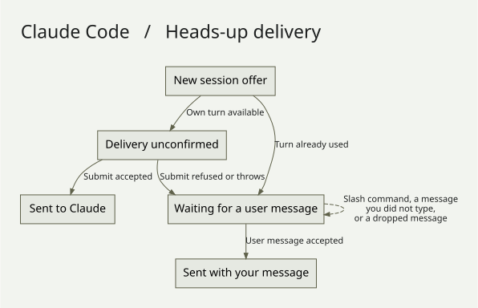

# HUD information paths

Keeping a thought appends a Log record. Sending Memory replaces a session instruction snapshot. A heads-up originates in session monitoring and has its own delivery history. The diagrams describe HUD’s evidence at each boundary.

| Transition | Effect |
| --- | --- |
| Edit during confirmation | Both hosts retain the previewed lines for this Send. Later edits stay in the draft. Pi discards an open decision when its session or tree changes. |
| Confirm and persist | The snapshot becomes eligible for instructions. Claude invalidates its prompt-section cache. Pi supplies its section at agent start. |
| Confirm an empty draft | Pi withdraws the section from future prompts. Claude’s pane offers Send for a nonempty draft. |
| Application receipt | Claude records the snapshot while composing its memory section. Pi reads system section patches in order and records a receipt when the final value of its section equals the approved text. Neither hook observes a provider acknowledgment. |
| Capture fails | Claude tries to preserve a failed keep in the pane. If that save also fails, the phone command reports both failures without echoing the thought. |

[Memory diagram source](memory.dot) · [Pi implementation](../index.ts) · [Claude implementation](../../../mods/binnacle-hud/hooks/register.tsx)

A duplicate offer with a turn ID already in the bounded note list is ignored. If the host stops between submission and the receipt write, **delivery unconfirmed** can persist. Automatically replaying that submission could start a second turn. When a queued user message succeeds, HUD records only the waiting notes it attached.

Pi has a separate observer. A valid empty review advances its cursor. A malformed initial reply leaves the cursor in place. A grounded candidate can undergo up to three rechecks against later turns. A tree change, session shutdown or successful mode change retires an outstanding review. Panel mode keeps an automatically surfaced note with the operator. Explicitly sending a note from the menu can start a turn. In forward mode, an idle agent receives an eligible note with the next user message. A busy agent receives a steer. A refused synchronous steer leaves the note waiting for the next message.

[Pi observer routing source](observer.dot), drawn with dark and light schemes on the [HUD page](https://mrbinnacle.github.io/skills/hud.html#plate-observer) alongside both figures above · [Claude diagram source](heads-ups.dot) · [Pi observer chart, model and bounds](../README.md#a-notes-life-checked) · [Pi request-capture integration test](../consent.test.ts) · [Claude routing tests](../../../mods/binnacle-hud/tests/headsups.test.tsx)
